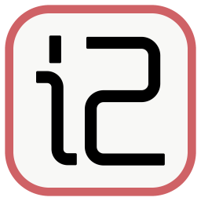
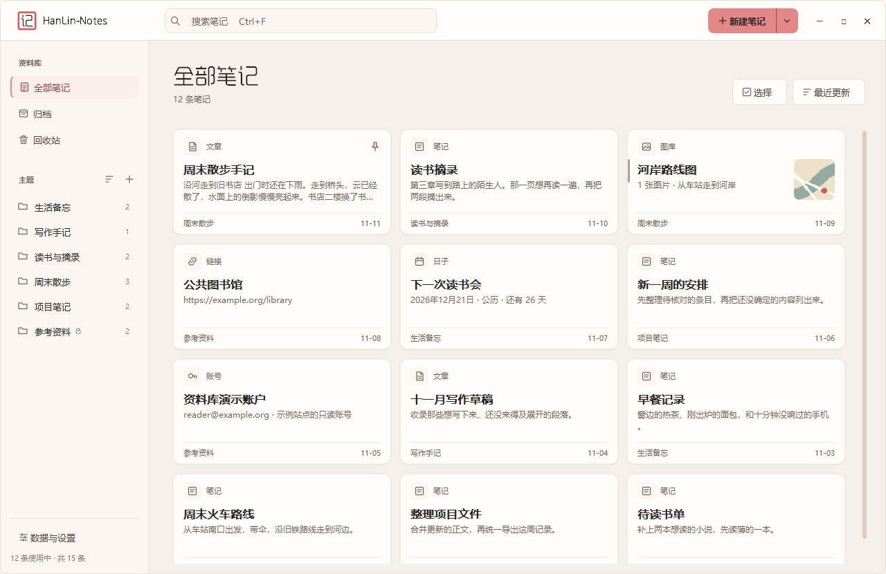
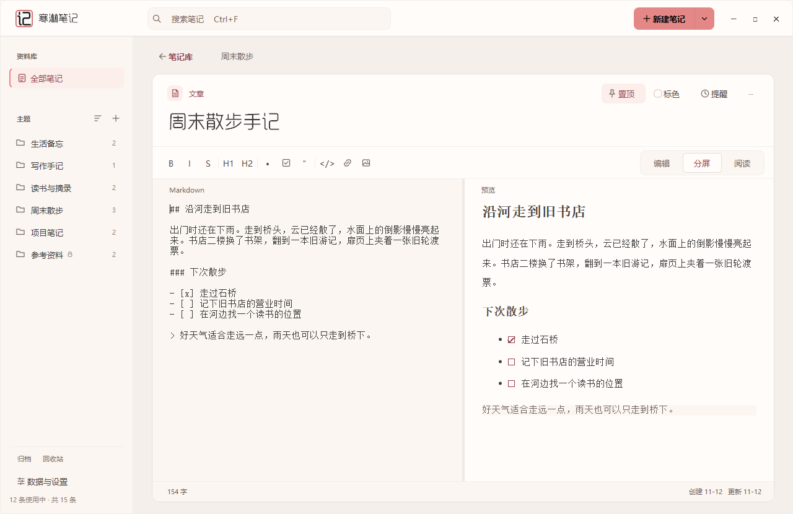
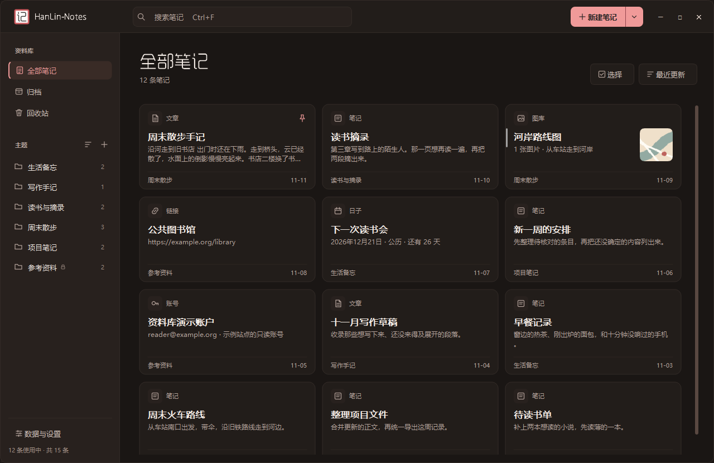
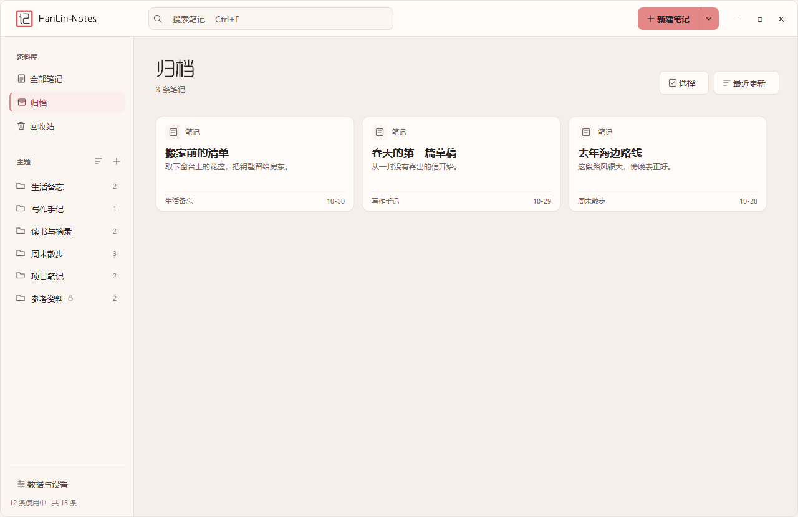

# HanLin-Notes



一个 Windows 本地笔记软件：**数据全在本机，不需要账号，不联网**。

HanLin-Notes 是独立开发的桌面软件。数据格式和部分交互沿用 Android 应用 [Timo笔记](https://timo.idik.net/) 的思路。可直接导入 Timo 的可读数据 ZIP，在电脑上整理后再导出回手机。桌面界面采用 HanLin 系列的暖白、珊瑚红配色，并提供深色模式。





在「数据与设置 → 设置 → 外观」可切换浅色、深色或跟随系统。也可用 `Ctrl+,` 进入设置。 [HanLin 系列设计规范](docs/HANLIN-SERIES.md)



> 与 Timo 官方无关，也不包含、不分发 Timo 的应用本体。本仓库只处理用户自己导出的数据。

## 下载

在 [Releases](../../releases/latest) 下载 Windows EXE 安装包。版本包可为 `HanLinNotes-<版本>.exe`，本地构建输出为 `HanLin-Notes-Setup-<版本>.exe`。

要求：Windows 10 / 11 64 位。

## 怎么用

### 1. 安装

双击安装包后点击「下一步」，选好安装位置并确认，完成页可选择打开应用。默认安装到 `%LOCALAPPDATA%\Programs\HanLin\HanLin-Notes`。升级已有便携版时，选择原来的程序文件夹便可接着使用原有笔记。

程序文件夹可直接启动，也可从开始菜单打开：

```
HanLin-Notes/
├── HanLin-Notes.exe   ← 双击这个启动
├── _internal/             ← 运行需要的 Qt 等 dll，别删
└── Data/                  ← 你的笔记数据
```

安装作用于当前 Windows 用户。可以从 Windows「设置 → 应用」卸载，程序旁的笔记数据保留在原文件夹。

### 2. 第一次打开

双击 `HanLin-Notes.exe`，会问你要不要导入手机上的数据：

1. 打开手机上的 Timo笔记 → 设置 → 导出可读副本，得到 `Timo_Export_xxxx.zip`；
2. 在欢迎页点 **导入 Timo ZIP**，选中那个 ZIP；
3. 等几秒，主题、笔记、图片、账号就都进来了。

也可以先从空白开始，再从左下角的「数据与设置 → 导入」导入。把 ZIP 拖到主窗口或 `HanLin-Notes.exe` 图标上也能导入。

库里已经有笔记时，导入会问一句：

- **合并导入**：保留现在的笔记，只把包里没有的新笔记加进来（正文不会被覆盖，适合手机又记了一些再导一次）；
- **替换导入**：清空当前库整体替换，动手前会自动备份到 `Data/backup/`。

### 3. 搬家 / 备份

所有东西都在这个文件夹里：

```
Data/
├── library.json      # 主题与笔记元数据
├── notes/*.md        # 每条笔记的正文（Markdown）
└── attachments/      # 图片等附件原件
```

要换电脑或备份，可以直接复制整个 `HanLin-Notes` 文件夹。要在手机上继续用，可以从「数据与设置 → 导出 → Timo ZIP」生成 ZIP，再导回手机。

### 4. 托盘

- 点窗口右上角的 **✕** 不会退出，而是收进系统托盘（右下角时间旁边）；
- **单击托盘图标** 重新打开窗口；
- **右键托盘图标**：打开 HanLin-Notes / 新建笔记 / 打开数据文件夹 / 退出。

## 功能

| 功能 | 说明 |
| --- | --- |
| 六种笔记类型 | 便签、文章、图库、账号、链接、日子。顶栏「新建笔记」直接新建便签，右侧箭头选择其他类型 |
| Markdown | 编辑 + 实时预览，支持粘贴图片、拖入图片文件 |
| 待办清单 | `- [ ]` 在预览里是可点的方框，点一下就打勾（直接写回正文） |
| 图库 | 批量添加图片、拖拽调整顺序、双击看大图；列表里能直接看到封面 |
| 整理 | 全库搜索（列表卡片与预览都会标出命中词）、置顶、8 档灰阶颜色标记、归档、回收站（可清空）、跨主题移动；列表上按 `Delete` 移到回收站 |
| 拖动 | 把笔记卡片拖到左侧任一主题上，直接移动过去（多选后可一起拖）；把 `.md` / `.txt` 文件拖进窗口会在当前主题新建一条笔记 |
| 导出 | 单条「复制为 Markdown」/「导出为 Markdown…」、「导出为 PDF…」；整个库可「导出为 Markdown 文件夹…」（按主题成目录，图片放 `attachments/`） |
| 清理 | 「数据与设置 → 整理数据 → 清理未使用的图片…」清理失去引用的附件 |
| 提醒 | 编辑器右上角「提醒」可设到点提醒（一小时后 / 今天 20:00 / 明天 9:00 / 自定义），到点从托盘弹出；卡片与顶部按钮会标出提醒时间 |
| 主题 | 新建、改名、删除、拖拽排序和锁定。删除时主题及其中笔记进入回收站，在「数据与设置 → 整理数据 → 已删除的主题…」中可找回 |
| 导入导出 | 与 Timo 官方 ZIP 结构兼容，可往返；已有数据时可选合并或替换；**导入会自动跳过内容重复的笔记**（同一个包导两次、或包里本来就有两条一样的，都只留最早那条），提示里会写跳过几条 |
| 深色模式 | 「数据与设置 → 外观」提供浅色、深色和跟随系统，选择会记住 |
| 自动保存 | 停顿 0.7 秒写盘，关窗时再存一次 |
| 自动备份 | 每次启动最多每天备份一次正文与库结构到 `Data/backup/`，保留最近 7 份，数据菜单可手动备份或回滚 |
| 设置 | 「数据与设置 → 偏好设置…」提供外观、正文字体、回收站自动清理天数和默认排序 |
| 数据检查 | 「整理数据 → 检查数据完整性…」列出正文缺失、引用缺图和未使用的附件 |
| 去重 | 「整理数据 → 查找重复笔记…」按正文找出相同的笔记，勾选后移到回收站 |

常用快捷键有 `Ctrl+N` 新建笔记、`Ctrl+Shift+N` 新建主题、`Ctrl+S` 保存、`Ctrl+E` 在分屏和阅读间切换、`Alt+←` 返回笔记库。`Ctrl+F` 在正文中查找，在其他位置进入全库搜索。`Ctrl+Shift+F` 可直接进入全库搜索，`Esc` 关闭或清空查找。

正文里还有：`Ctrl+B` 粗体、`Ctrl+I` 斜体、`Ctrl+K` 链接、`Ctrl+Shift+T` 待办、`Ctrl+Shift+1/2` 一/二级标题。

### 界面

笔记库用自适应网格浏览和整理，左侧切换主题、归档与回收站，顶栏一直保留搜索和新建。单击卡片或选中后按回车打开文档。整理多条笔记时可点「选择」逐条选中，也可按住 Ctrl 或 Shift 选中后右键操作或拖到目标主题。

文档页提供按类型组织的字段。便签和文章可直接切换编辑、分屏和阅读，其他类型分别展示图片与说明、登录凭据、链接地址或日期。文档右上角提供单条笔记操作。「笔记库」按钮返回当前集合与卡片位置。关闭 Windows 动画效果时，页面直接切换。



## 已知说明

- 密码以明文保存在 `library.json`（与 Timo 导出的 `accounts.csv` 一致）。程序不加密、不联网，别把数据目录发给别人。
- 回收站默认关闭自动清理。在「设置 → 数据」可选择清理周期。
- 手机端的云同步、桌面小组件没有移植；提醒是本地功能，Timo 导出包不带提醒字段，所以**导出回手机时提醒会丢**，其余内容不受影响。
- 首次导入 1000 条笔记约需 5 秒。
- 如果把程序放在 U 盘里用，`Data/` 会跟着 U 盘走；U 盘拔掉前先退出程序。

## 从源码运行

```bat
pip install PyQt5 markdown
python run.py
```

用 PyInstaller 和 Inno Setup 6.6 或更新版本构建程序目录与安装包：

```bat
python tools/make-portable.py --dist <输出目录> --work <构建目录>
```

不传 `--dist`/`--work` 时默认用仓库下的 `dist/` 与 `build/`。`tools/make-release.py <版本>` 只从默认的 `dist/` 取安装包整理发布资产，所以用自定义输出目录时，要把它复制回 `dist/` 再生成 `SHA256SUMS.txt`。

产物：

- `dist/HanLin-Notes/HanLin-Notes.exe` 为程序目录里的启动文件。
- `dist/HanLin-Notes-Setup-<版本>.exe` 为系列 Windows 安装包。

## 开发

- 分支模型：`snapshot` 是日常工作分支，`master` 只接受 `git merge --ff-only snapshot`，发版时打 tag 并发布 Release。
- 每次改动追加一条到 `PENDING-CHANGES.md`，发版时汇总进 `CHANGELOG.md`。

## 许可

[MIT](LICENSE)
